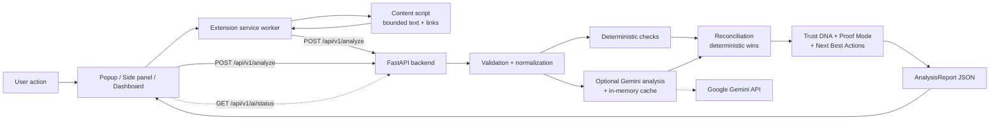

# Credible — Know before you trust.

Credible is a defensive Chrome extension and analysis backend that checks a job
posting, offer, or message for deception signals before you act on it. It shows
its evidence, its uncertainty, and which checks actually ran.

Scans are user-initiated only. Credible does not watch browsing, auto-scan tabs,
or run in the background.

## What it does

- **Page scan** — extracts the visible text and links of the active tab after you
  click **Scan This Page**.
- **Select-to-Verify** — right-click a selected passage and choose
  **Verify with Credible**.
- **Deterministic checks** — URL structure, payment pressure, urgency, credential
  requests, data exposure, and unrealistic promises.
- **Optional AI interpretation** — Gemini adds contextual reasoning on top of the
  rules. If it is unavailable, the scan still completes deterministically.
- **Trust DNA** — six evidence-backed dimensions with explicit `unknown` states.
- **Proof Mode** — each finding traced to what was observed and which check
  produced it.
- **Next Best Actions** — proportionate verification steps, not alarm.
- **Dashboard** — full-tab verdict sheet, heuristic matrix, scan ledger, and
  dossier export.

## Architecture



The backend **never fetches the scanned URL**. It analyzes only the bounded
payload sent by the extension, which is the explicit SSRF boundary.

- **Extension (Chrome MV3):** React + TypeScript + Vite. Popup for scan triggers,
  side panel for results, dashboard for the full case file.
- **Backend:** Python + FastAPI + Pydantic. Strict validation, normalization,
  deterministic checks, optional Gemini analysis, output validation, and report
  composition.
- **Reconciliation:** deterministic evidence takes precedence; AI cannot
  escalate, downgrade, or suppress a documented rule result.

## Project structure

```
credible-pro/
├── backend/               # FastAPI service, analysis pipeline, tests
│   ├── app/
│   ├── scripts/           # check_ai.py credential probe
│   ├── tests/
│   ├── .env               # local secrets (gitignored)
│   └── requirements*.txt
├── extension/             # Manifest V3 extension (popup, side panel, dashboard)
│   ├── src/
│   ├── tests/
│   ├── manifest.json
│   └── vite.config.ts
├── demo/                  # Five local scenarios + demo HTTP server
│   ├── pages/
│   ├── server.py
│   └── README.md
├── doc/                   # Product, technical, API, and task docs
├── PRODUCT.md
├── DESIGN.md
└── README.md
```

## Prerequisites

| Tool | Version used for the current suite |
|---|---|
| Python | 3.14.3 (3.11+ should work) |
| Node.js | 24.15.0 (20+ should work) |
| npm | 12.0.2 |
| Browser | Chrome or Chromium with Manifest V3 support |

No API key is required. Gemini adds AI interpretation when a key is configured.

## Quick start

### 1. Backend

Windows PowerShell:

```powershell
cd backend
python -m venv .venv
.\.venv\Scripts\python.exe -m pip install -r requirements-dev.txt
.\.venv\Scripts\python.exe -m pytest -v
.\.venv\Scripts\python.exe -m uvicorn app.main:app --reload --port 8000
```

macOS / Linux:

```bash
cd backend
python3 -m venv .venv
source .venv/bin/activate
pip install -r requirements-dev.txt
pytest -v
uvicorn app.main:app --reload --port 8000
```

Confirm the service is up:

```bash
curl http://localhost:8000/health
```

Interactive API docs are at `http://localhost:8000/docs`.

### 2. Configure AI (optional)

Create `backend/.env` (gitignored) and add:

```dotenv
AI_PROVIDER=auto
AI_PROVIDER_ORDER=gemini

GEMINI_API_KEY=your_gemini_key
GEMINI_MODEL=gemini-3.5-flash-lite
```

Restart `uvicorn` after changing the file, then verify the key without spending
tokens:

```powershell
cd backend
.\.venv\Scripts\python.exe scripts\check_ai.py --no-probe
```

Run the same command without `--no-probe` for a live, low-cost probe.

### 3. Extension

```bash
cd extension
npm install
npm test
npm run build
```

Load the extension:

1. Open `chrome://extensions`.
2. Enable **Developer mode**.
3. Click **Load unpacked** and select `extension/dist`.
4. Pin the Credible icon.

The extension expects the backend at `http://localhost:8000`. If you run it
elsewhere, change `BACKEND_BASE_URL` in `extension/src/config.ts` and rebuild.

### 4. Demo pages

From the repository root:

```bash
python demo/server.py --port 8080
```

Open `http://localhost:8080/index.html` for the scenario hub, then run a scan from
the extension. The runbook with expected results for each scenario is
[`demo/README.md`](demo/README.md).

### 5. First scan

1. Keep the backend running.
2. Open `http://localhost:8080/benign.html`.
3. Click the Credible icon, then **Scan This Page**.
4. The side panel opens with live progress and then the report.
5. Click **Open Dashboard** in the popup for the full case file.

## Configuration reference

All backend settings load from `backend/.env` (absolute path, independent of the
current working directory). Environment variables override the file. Keys belong
only in this file or in a CI/deployment secret store — never in `extension/`,
source code, logs, or a commit.

### Core service

| Variable | Default | Purpose |
|---|---|---|
| `APP_NAME` | `Credible API` | Service name in `/health` and the OpenAPI docs. |
| `APP_VERSION` | `0.1.0` | Version reported by `/health`; keep in sync with extension versions. |
| `HOST` | `127.0.0.1` | Declared for embedders. The documented `uvicorn` command binds explicitly. |
| `PORT` | `8000` | Declared for embedders. The documented `uvicorn` command binds explicitly. |
| `DEBUG` | `false` | Declared for future use; it has no effect in the current build. |

### CORS

| Variable | Default | Purpose |
|---|---|---|
| `CORS_ORIGINS` | `http://localhost:5173,http://127.0.0.1:8000` | Comma-separated list or JSON array of allowed browser origins. |
| `CORS_ORIGIN_REGEX` | `^chrome-extension://[a-p]{32}$` | Matches any unpacked Chrome extension origin. CORS is not authentication. |

### Content bounds

| Variable | Default | Purpose |
|---|---|---|
| `MAX_PAGE_TEXT_CHARS` | `50000` | Maximum page text analyzed; truncation is disclosed in limitations. |
| `MAX_SELECTION_TEXT_CHARS` | `5000` | Maximum selected text analyzed. |
| `MAX_LINKS_COUNT` | `200` | Maximum links accepted by the backend. The extension sends at most 100. |

### AI

| Variable | Default | Purpose |
|---|---|---|
| `AI_PROVIDER` | `auto` | `auto`, `gemini`, or `disabled`. |
| `AI_PROVIDER_ORDER` | `gemini` | Provider chain; only `gemini` is registered. |
| `GEMINI_API_KEY` | empty | Enables Gemini when non-empty. |
| `GEMINI_MODEL` | `gemini-3.5-flash-lite` | Gemini model id. |
| `AI_TIMEOUT_SECONDS` | `60` | Per-attempt limit; one transient retry is allowed. |
| `AI_TOTAL_TIMEOUT_SECONDS` | `70` | Whole AI-stage budget. The extension client waits 80s. |
| `AI_MAX_INPUT_CHARS` | `20000` | Text sent to the model. Deterministic checks still use the full page text. |
| `AI_CACHE_ENABLED` | `true` | Cache validated AI results in process memory. |
| `AI_CACHE_TTL_SECONDS` | `900` | Cache entry lifetime (15 minutes). |
| `AI_CACHE_MAX_ENTRIES` | `128` | LRU eviction threshold. |

See [`doc/API_INTEGRATION.md`](doc/API_INTEGRATION.md) for provider modes, the
failure matrix, the status endpoint, and the cache fingerprint.

### Provider behavior

| Setting | Behavior |
|---|---|
| `AI_PROVIDER=auto` | Use Gemini when `GEMINI_API_KEY` is present, otherwise deterministic-only. |
| `AI_PROVIDER=gemini` | Gemini only; a missing key produces a clear limitation, not a crash. |
| `AI_PROVIDER=disabled` | Deterministic-only; no provider is initialized. |

The AI cache key is a SHA-256 hash of the model name and exact prompt, so any
change to the URL, visible text, or deterministic signals is a cache miss. Only
validated successes are stored; failures, timeouts, and malformed output are
never cached. The cache is per backend process and is cleared on restart.

## Privacy boundary

The extension sends only:

- page URL, page title, and bounded visible text (50,000 characters);
- up to 100 links with their text and `href`;
- the selected passage in selection mode (5,000 characters);
- extension version and the browser user agent.

It does **not** collect password values, hidden input values, payment field
values, cookies, `localStorage`, `sessionStorage`, or unrelated form data.
Content extraction runs only after a user action.

The backend does not fetch the URL. Reports are stored in `chrome.storage.local`
for the dashboard until you clear history. AI results are cached in backend
memory only.

## Test commands

| Goal | Command | Location |
|---|---|---|
| Backend full suite | `python -m pytest -v` | `backend/` (venv active) |
| Backend single file | `python -m pytest -v tests/test_pipeline.py` | `backend/` |
| Extension typecheck | `npm run typecheck` | `extension/` |
| Extension tests | `npm test` | `extension/` |
| Extension production build | `npm run build` | `extension/` |
| AI configuration check | `python scripts/check_ai.py --no-probe` | `backend/` |
| Live AI probe (spends tokens) | `python scripts/check_ai.py` | `backend/` |
| Backend health | `curl http://localhost:8000/health` | any terminal |

If the venv is not activated on Windows, prefix Python commands with
`.\.venv\Scripts\python.exe`.

## Demo walkthrough

| Scenario | Page | What to look for |
|---|---|---|
| Benign listing | `/benign.html` | `CLEAN SIGNALS` or `CAUTION / UNVERIFIED`; zero high/critical findings; no fabricated warnings. |
| Suspicious scam | `/suspicious.html` | `CRITICAL THREAT DETECTED` or `CAUTION / UNVERIFIED`; payment pressure, urgency, credential, and data-exposure findings with evidence. |
| Ambiguous offer | `/ambiguous.html` | Mixed signals; a score without a fabricated identity claim; `unknown` Trust DNA dimensions. |
| Prompt injection | `/prompt-injection.html` | Never `CLEAN SIGNALS`; deterministic findings survive the page's override text. |
| Offline / fallback | `/error-demo.html` | Stop the backend for a clear connection error with **Try Again**; remove the API key for deterministic-only results. |

Full step-by-step instructions, including Select-to-Verify, are in
[`demo/README.md`](demo/README.md). Expected labels are qualitative: scores can
change when rules or page content change.

## Known limitations

- **Text-only evidence.** The backend does not fetch the site, resolve DNS, check
  WHOIS/registry records, inspect TLS, or visit links. Trust DNA reports `unknown`
  where it has no evidence.
- **The score is heuristic, not a probability.** A high score does not prove a
  page is safe; a missing warning is not proof of safety.
- **Extraction coverage.** Only visible DOM text is read. Iframes, canvas, SVG,
  media, hidden content, and form values are skipped. Page text is capped at
  50,000 characters and 100 links; selections at 5,000 characters. Truncation is
  recorded in limitations.
- **AI is optional and best-effort.** Gemini is the only provider. Free-tier
  latency and daily quotas apply; a scan can take 20-60 seconds. Timeouts,
  rate limits, and provider outages degrade to deterministic results with an
  explicit limitation.
- **AI cache is local to one process.** A restart clears it, and multiple backend
  workers do not share entries.
- **Local-first security posture.** The backend has no authentication, rate
  limiting, or TLS. CORS is not access control. Keep it bound to `127.0.0.1` and
  put it behind a gateway with auth, TLS, and rate limits before exposing it.
- **Chromium only.** The extension targets Manifest V3 in Chrome/Chromium. It is
  not packaged for Firefox or Safari.
- **External font request.** All three surfaces load Plus Jakarta Sans and
  JetBrains Mono from `fonts.googleapis.com`. That is a third-party request made
  by the browser and the reason the intended typography falls back when offline.
- **Manual visual checks.** UI behavior is covered by unit tests, but there is no
  automated screenshot or visual-regression suite.

## Troubleshooting

| Symptom | Check |
|---|---|
| Badge says `ENGINE OFFLINE` | Backend not running, wrong port, or blocked by CORS. Run `curl http://localhost:8000/health`. |
| Badge says `AI DEGRADED · GEMINI` | Key missing/invalid, quota, timeout, or network. Run `scripts/check_ai.py`; deterministic results still work. |
| `Browser and extension pages cannot be inspected` | `chrome://`, the Web Store, and other extension pages are off-limits. Open a normal website tab. |
| `The page could not be read` | Reload the target tab after installing or updating the extension, then scan again. |
| Scan fails immediately | Confirm the backend is on port 8000 and `extension/src/config.ts` points at it. |
| CORS error in the console | Confirm the backend is running with the default extension regex, and reload the extension after a rebuild. |
| Port already in use | Pick another port for `uvicorn`/the demo server; update `BACKEND_BASE_URL` if the backend changes. |
| Type looks different offline | The Google Fonts request cannot complete; local fallbacks are used. |

## Release checklist

- [ ] Keep versions in sync: `extension/manifest.json`, `extension/package.json`,
  `extension/src/config.ts` (`EXTENSION_VERSION`), and
  `backend/app/core/config.py` (`APP_VERSION`).
- [ ] Confirm `git status` contains only intended files and `backend/.env` is
  ignored (`git check-ignore backend/.env` should print the path).
- [ ] Confirm no real keys are staged; documentation contains placeholders only.
- [ ] Backend: `python -m pytest -v` passes.
- [ ] Extension: `npm run typecheck`, `npm test`, and `npm run build` pass.
- [ ] `python scripts/check_ai.py --no-probe` shows the intended provider mode.
- [ ] Load `extension/dist` unpacked and run all five demo scenarios, including
  one scan with the backend stopped.
- [ ] Confirm scans remain user-initiated and manifest permissions are unchanged.
- [ ] Confirm the status badge is truthful with the key absent and present.
- [ ] If publishing, tag the release and distribute the built `extension/dist`.

## Documentation

- [`doc/API_INTEGRATION.md`](doc/API_INTEGRATION.md) — API contract, AI modes,
  fallback matrix, cache, and status endpoint.
- [`doc/TECH_SPEC.md`](doc/TECH_SPEC.md) — backend and extension technical design.
- [`doc/PRODUCT_SPEC.md`](doc/PRODUCT_SPEC.md) and [`doc/prd.md`](doc/prd.md) —
  product requirements.
- [`PRODUCT.md`](PRODUCT.md) and [`DESIGN.md`](DESIGN.md) — product and visual
  context for the dashboard.
- [`demo/README.md`](demo/README.md) — reproducible demo runbook.
- [`doc/AGENT_TASKS.md`](doc/AGENT_TASKS.md) — implementation task ledger.
